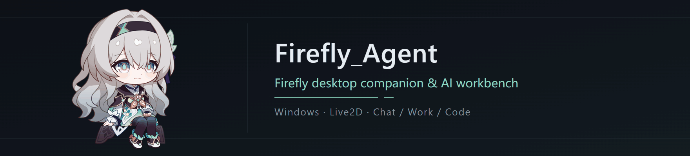

<p align="center">
  
</p>
<p align="center">
  
</p>
<p align="center">
  
  
  
  
  
</p>

<p align="center"><b>A desktop Firefly who chats with you, and helps you finish the work too.</b></p>

<p align="center">
  <a href="./README.md">中文</a> ·
  <strong>English</strong> ·
  <a href="https://github.com/Serendipity-wu02/Firefly_Agent/issues">Issues</a>
</p>

---

Firefly_Agent is a **Windows desktop companion and AI workspace** featuring Firefly from *Honkai: Star Rail*.

She lives on your desktop: she blinks, answers a double-click, and now and then sends a sticker on her own when the mood fits. When there is work to do, the same Firefly can read files, edit code, look things up and organize documents, then put the result in front of you instead of just saying "done".

## What she can do

**Chat, like talking to someone**
The character is injected in layers, so tone, forms of address and the things she cares about stay consistent. Replies stream in and conversations can be revisited. She sends stickers on her own when the mood fits, and the angry one never turns up right after a happy one.

**Work, with every step visible**
Work handles files, documents and materials; Code reads and writes code inside the workspace you link, with Git, LSP, AST and command tools. Tool calls, approvals and cancellation are shown as they happen, and a finished Work task can be exported as Markdown. Learning, quizzes, notes and progress live in Work too, once you link an existing Obsidian Vault or study-material folder.

**Remembers, and tells things apart**
Default memory has three layers: S is the current conversation context, M is fact memory across sessions, H is history retrieval. When H has no trustworthy snapshot it reports insufficient coverage instead of pretending nothing happened. The context window defaults to 1M tokens and can be changed per model profile; at 85% it is compacted automatically so long tasks do not lose the thread.

**Reaches the web, but does not wander**
A built-in browser workspace keeps *you browsing* and *Firefly acting for you* as two separate things. The Agent only acts inside the domains and actions you approved, does not enter sign-in, sign-up or payment pages, does not type into password, card or ID-number fields, and always treats page content as untrusted external text.

**Plugs into your own tools**
Skills, local plugins, MCP services, and WeChat, Feishu and QQ channels (channels are chat-only by default, with no tools). Anything that starts a command or changes something outside, such as installing an MCP server or sending email, shows a confirmation card first, and the card is voided if the task is cancelled.

## Take a look

| Light | Dark · Firefly |
| --- | --- |
|  |  |


<sub>Screenshots come from the current build of this repository, using a demo conversation and an isolated development data directory. They contain no real conversations or credentials. The translucent glass of the window is drawn by the system and does not show up in them.</sub>

## Quick start

You need Windows, Node.js `>=24 <25`, npm `>=10`, and your own model service (protocol, address, model and credentials go into settings).

```powershell
git clone https://github.com/Serendipity-wu02/Firefly_Agent.git
cd Firefly_Agent
npm ci
$fireflyDevRoot = Join-Path (Get-Location).Path "output\development-profile"
New-Item -ItemType Directory -Force -Path $fireflyDevRoot | Out-Null
$env:FIREFLY_RUNTIME_PROFILE = "development"
$env:FIREFLY_ISOLATION_ROOT = (Resolve-Path -LiteralPath $fireflyDevRoot).Path
npm run dev
```

The development instance keeps its data in that isolation directory and never touches production data (`%APPDATA%\Firefly`). After the first launch:

1. **Settings → Models**: create a model profile, choose the protocol, enter the address and key, save it and select it. Leave the context window empty to use 1M.
2. Pick **Chat / Work / Code**; Work and Code bind a workspace per task.
3. Turn on tools, Skills, plugins or MCP in settings as you need them.

To build and start from source, run `npm run build` and then `npm start` in the same PowerShell session where the isolation variables are set. More scripts are listed in [scripts/README.md](./scripts/README.md).

<details>
<summary>Development checks and local packaging</summary>

```powershell
npm run check:renderer
npm test
npm run check:plugin-sdk
npm run test:plugin-examples
npm run validate:skills
npm run package:win:dir
```

`package:win:dir` produces an unpacked Windows directory and needs Rust/Cargo (Windows MSVC) plus the C++ build tools to build the screenshot and history helpers; it is not an installer upgrade or a public-release validation. The Windows Bash integration tests need `FIREFLY_TEST_BASH` set for your local install, and the history-helper tests need `FIREFLY_HISTORY_PRESENCE_TEST_HELPER`.
</details>

## Project map

| Path | Responsibility |
| --- | --- |
| `src/main/`, `src/preload/`, `src/renderer/` | Application services, controlled bridge, React UI and Live2D |
| `src/main/orchestrator/` | Agent orchestration, tool execution, specialist Agents and permissions |
| `src/main/memory-context/` | The S/M/H memory chain |
| `src/main/browser/` | Browser workspace and network policy |
| `src/main/skills/`, `skills/`, `vendor/firefly-skills/` | Skill discovery, reading and built-in content |
| `src/plugins/`, `packages/plugin-sdk/`, `examples/` | Plugin host, SDK and examples |
| `src/shared/` | IPC, data and event contracts |
| `prompts/`, `assets/` | Layered character prompts, world-building material and product resources |
| `native/` | Native helper source |

Read [AGENTS.md](./AGENTS.md) before developing. Do not attach secrets, private conversations or user data to issues or PRs.

## Boundaries, up front

- **Bring your own**: model services, language servers, office applications, speech recognition, knowledge embedding resources and channel credentials. An entry point being present does not mean the service is configured.
- **Where data goes**: settings, credentials, history and user Skills are not in Git or installation packages. Depending on the service and operation you choose, conversations, materials, tool results and recordings may be sent to external services. Exit and back up before handling data by hand.
- **Not fully validated yet**: real-model end-to-end runs, a complete deep Windows GUI pass, microphone and ASR, external office workflows, installer upgrades and cross-platform support. Automatic updates are off, and a public installer, a project-run online plugin marketplace or a published SDK package are not promised.
- **UI**: settings are Chinese-only for now; the chat-window language takes effect after a restart.
- **Model differences**: image input is decided by *your declaration → the provider's model list → the built-in catalog*, and falls back to text-only when it cannot be confirmed; reasoning replay and similar behavior depend on the upstream service.

## License and character assets

Source code is licensed under the [MIT License](./LICENSE). Some implementation derives from [Cyrene-Agent](https://github.com/Playa-0v0/Cyrene-Agent), with the original copyright notices retained. Third-party dependencies, Skills, models, images and character IP each remain subject to their own licenses or permissions.

The project owner confirms authorization from the original creator of the Firefly model. Verifiable creator attribution, written terms, covered files and redistribution scope have not yet been archived in the repository, so the specific scope of public redistribution cannot be established from that statement. Model authorization does not automatically cover avatars, task portraits, icons, stickers or derived renders, and the source-code MIT license grants no redistribution rights to those assets. See [MODEL_LICENSE.md](./MODEL_LICENSE.md) and [THIRD_PARTY_NOTICES.md](./THIRD_PARTY_NOTICES.md).

Firefly and the characters and intellectual property of *Honkai: Star Rail* belong to HoYoverse / miHoYo and the respective rights holders. This is an unofficial project.

The banner uses a render of the model already in the repository. The five technology badges use Shields-generated graphics and Simple Icons marks; sources and licenses are in the [icon notes](./readme-assets/ICON_SOURCES.md). Technology badges do not imply tested results or an official affiliation.
