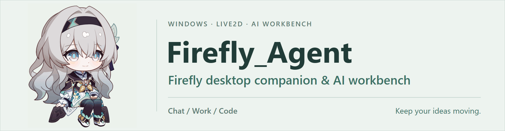

<p align="center"><a href="./README.md">简体中文</a> · <b>English</b></p>

<p align="center">
  <picture>
    <source media="(prefers-color-scheme: dark)" srcset="./readme-assets/firefly-banner-dark.en.gif">
    <source media="(prefers-color-scheme: light)" srcset="./readme-assets/firefly-banner-light.en.gif">
    
  </picture>
</p>

<p align="center"><b>Talk with Firefly. Turn ideas into actions you can build on.</b></p>

<p align="center">
  <picture>
    <source media="(prefers-color-scheme: dark)" srcset="./readme-assets/electron-dark.svg">
    <source media="(prefers-color-scheme: light)" srcset="./readme-assets/electron-light.svg">
    
  </picture>
  <picture>
    <source media="(prefers-color-scheme: dark)" srcset="./readme-assets/typescript-dark.svg">
    <source media="(prefers-color-scheme: light)" srcset="./readme-assets/typescript-light.svg">
    
  </picture>
  <picture>
    <source media="(prefers-color-scheme: dark)" srcset="./readme-assets/react-dark.svg">
    <source media="(prefers-color-scheme: light)" srcset="./readme-assets/react-light.svg">
    
  </picture>
  <picture>
    <source media="(prefers-color-scheme: dark)" srcset="./readme-assets/rust-dark.svg">
    <source media="(prefers-color-scheme: light)" srcset="./readme-assets/rust-light.svg">
    
  </picture>
  <picture>
    <source media="(prefers-color-scheme: dark)" srcset="./readme-assets/sqlite-dark.svg">
    <source media="(prefers-color-scheme: light)" srcset="./readme-assets/sqlite-light.svg">
    
  </picture>
</p>

<p align="center">A Windows Live2D desktop companion and AI workbench featuring Firefly from Honkai: Star Rail.</p>

<p align="center">
  <a href="#install-and-run">Install and run</a> · <a href="#features">Features</a> · <a href="#interface-preview">Interface preview</a> · <a href="#configure-and-use">Configure and use</a> · <a href="#status-and-limitations">Status and limitations</a><br>
  <a href="https://github.com/Serendipity-wu02/Firefly_Agent">Repository</a> · <a href="https://github.com/Serendipity-wu02/Firefly_Agent/issues">Issues</a>
</p>

## Features

| Chat · Desktop companion | Work · Move tasks forward | Code · Code workspace |
| --- | --- | --- |
| Character conversations, streamed replies, and history.<br>Live2D expressions and idle motion. | Process files and knowledge, use tools and Skills, and collaborate with specialist Agents. | Use Git, LSP, AST, file and command tools in a linked workspace. |

<details>
<summary>View the full capabilities and usage boundaries</summary>

- **Desktop Firefly and Chat**: a Live2D character with double-click expressions, dragging, and idle animations; character conversations, model profiles, streamed replies, and conversation history.
- **Work**: process files, documents, and knowledge materials, use tools and Skills, and collaborate with specialist Agents. Tool execution, approvals, and cancellation are visible. Finished Work tasks can be exported as Markdown; task completion and complete file reading are reported separately.
- **Code**: read and work on code in a linked workspace using Git, LSP, AST, file, and command tools. Language servers require the appropriate language environment.
- **Models and images**: an OpenRouter preset and Chat Completions entry point are available. Image input is determined through user declarations, provider model-list metadata, and the built-in catalog; unknown capabilities fall back to text-only input. Results depend on the selected model and service.
- **Knowledge workspace**: learning, quizzes, notes, and progress are part of Work. Link an existing workspace first. Progress is maintained only for a Vault that already has `learn/progress.md`; ordinary tasks do not automatically create learning folders.
- **Memory and knowledge**: the default chain uses S/M/H context, fact memory, and history retrieval, with SQLite supporting the current memory core. Character and document knowledge RAG remain separate.
- **Web and extensions**: web search, page-text retrieval, and a browser workspace are available. Manual browsing and Agent authorization are separate; Agents operate only within the scope currently approved by Main. Skills can be enabled by mode and overridden by users. Local plugins, isolated panels, and external MCP services are also supported.

The current conversation modes are **Chat / Work / Code**. Chat does not delegate to specialist Agents. General tool enhancement requires explicit enablement and selection; built-in character tools retain their own switches. Specialist Agents are available in Work / Code and need a usable model profile assigned in settings. Characters, Skills, and portraits do not automatically expand tool permissions.

</details>

Chat does not delegate to specialist Agents. Work / Code require usable model profiles assigned to specialist Agents. Characters, Skills, and portraits do not automatically expand tool permissions.

## Interface preview

  <picture>
    <source media="(prefers-color-scheme: dark)" srcset="./readme-assets/screenshots-pending-dark.en.svg">
    <source media="(prefers-color-scheme: light)" srcset="./readme-assets/screenshots-pending-light.en.svg">
    
  </picture>

**Real interface screenshots are still needed**: desktop Firefly and Chat, Work tasks and approvals, and Code and knowledge workspaces. The banner renders the existing Live2D model and does not replace real application screenshots.

## Requirements

| Item | Requirement |
| --- | --- |
| System | Windows is the primary development and validation platform |
| Node.js | `>=24 <25` |
| npm | `>=10`; the project declares `npm@11.17.0` |
| Model service | Configure a supported protocol, endpoint, model, and your own credentials |
| Optional external tools | Prepare language servers, office applications, ASR, knowledge embedding resources, and channel services as needed |

Local packaging also requires the Rust/Cargo Windows MSVC toolchain and C++ build tools for the screenshot and history helpers. The source repository does not include ready-to-use models, voice resources, or account credentials.

## Install and run

Get the source in PowerShell:

```powershell
git clone https://github.com/Serendipity-wu02/Firefly_Agent.git
cd Firefly_Agent
npm ci
```

Create a development isolation directory inside the repository, then start the app:

```powershell
$fireflyDevRoot = Join-Path (Get-Location).Path "output\development-profile"
New-Item -ItemType Directory -Force -Path $fireflyDevRoot | Out-Null
$env:FIREFLY_RUNTIME_PROFILE = "development"
$env:FIREFLY_ISOLATION_ROOT = (Resolve-Path -LiteralPath $fireflyDevRoot).Path
npm run dev
```

The isolation root must be an existing absolute directory. It must not equal, contain, or be inside the production appData directory; invalid configurations are rejected. `npm run dev` explicitly selects development, with data stored in `Firefly-development` beneath that isolation root.

To run the build output from the current source, use **the same PowerShell session with the variables above already set**:

```powershell
npm run build
npm start
```

`npm start` loads this repository's dist output. Rebuild after source changes. Set the development isolation variables again in a new terminal, and exit the current instance before starting another one.

Common development checks and local unpacked-build preparation are defined in [package.json](./package.json):

```powershell
npm run check:renderer
npm test
npm run check:plugin-sdk
npm run test:plugin-examples
npm run validate:skills
npm run package:win:dir
```

`package:win:dir` builds the app and native helpers, prepares MinGit, and produces an unpacked Windows directory. This does not establish installer-upgrade, real-environment, or public-release readiness. Windows Bash integration tests require `FIREFLY_TEST_BASH` to match the actual local installation. See [scripts/README.md](./scripts/README.md) for more scripts.

## Configure and use

1. Create a model profile in settings. Enter the protocol, endpoint, model, and your own credentials supported by the service, save it, and select the profile. OpenRouter has an existing preset. Image capability can be set to Auto, Image, or Text-only; a user override replaces the provider's model-list declaration.
2. Choose Chat, Work, or Code. Link a workspace for Work / Code tasks and assign saved model profiles to the specialist Agents you need. Missing configuration produces an explicit error.
3. Enable tools, Skills, plugins, or MCP as needed. Follow the current approval and cancellation mechanisms for file writes, command execution, and external operations.
4. Use an existing Obsidian Vault or learning-material directory for the knowledge workspace. Progress updates depend on existing files and service results; they are not guaranteed after every reply.
5. Desktop ASR offers Off, Mossland, and Alibaba Cloud. Recording starts only through an explicit action. After stopping, transcription fills the input draft without automatically sending it. The desktop Call / TTS product entry points have been retired.
6. Scheduled tasks are in the chat sidebar's **More / 更多** menu. The phone connection page in settings retains channel configuration. The Firefly mobile app is currently only a reserved connection slot, with pairing disabled.

The default memory chain separates current context, fact memory, and history retrieval. H reports insufficient coverage when a trusted history snapshot is unavailable; this does not establish that no history exists. Knowledge RAG / BGE-M3 needs separate configuration and does not provide the default personal-memory or history-retrieval chain.

Production data defaults to `%APPDATA%\Firefly`; development instances use the isolation directory above. Settings, credentials, history, and user Skills do not belong in Git or installation packages. Exit and back up before handling them manually, and preserve the original directory. Conversations, materials, tool results, and recordings may be sent to external services depending on the selected service and operation.

## Status and limitations

The project is under active development. Feature entry points, automated checks, and validation in real environments are separate claims; historical test counts are not used as evidence for the current version.

- **Bring your own services and tools**: model services, knowledge embedding resources, ASR, QQ Music, office applications, language servers, and channel credentials. An available entry point does not mean its service is configured and usable.
- **Full validation is still needed**: real-model end-to-end runs, extensive GUI testing, real user environments, microphones and ASR, the complete QQ Music approval flow, external office workflows, installer upgrades, and cross-platform compatibility.
- **Browser boundaries**: manual consent does not authorize Agent operations. Agents can use only approved domains and actions and cannot authorize themselves. Full validation of the real Windows GUI is still pending.
- **UI boundaries**: settings are currently Chinese-only. The chat-window language selection takes effect after a restart; a complete English settings UI is not available. The old Live2D action tool and runtime-status cards have been removed. Double-click expressions and the working expression during tool execution remain.
- **Model compatibility**: OpenRouter presets, reasoning-field mapping, and image-capability resolution are integrated. Reasoning replay, complete streaming-error compatibility, and real model endpoints still require validation against each upstream service. Support for every model capability is not promised.
- **Maintenance boundaries**: the original cause of the first empty history list remains unknown. Read failures being presented as empty lists and subsequent file overwrites have been fixed; a successful reopen does not resolve the original root cause.
- **Release status**: automatic updates remain disabled. Public installation packages, a project-run online plugin marketplace, and a published SDK package are not currently promised. Documentation of public redistribution rights for character assets is still pending.

## Architecture and directories

The app starts from `src/main/index.ts`, compiled to `dist/main/main/index.js`. Preload provides controlled IPC; React and Live2D handle the windows and desktop presentation.

| Path | Responsibility |
| --- | --- |
| `src/main/`, `src/preload/`, `src/renderer/` | Application services, controlled bridge, React UI, and Live2D |
| `src/main/orchestrator/` | Firefly Agent orchestration, tool execution, specialist Agents, and permission integration |
| `src/main/skills/`, `skills/` | Skill discovery, registration, reading, and project-built content |
| `vendor/firefly-skills/`, `scripts/packaging/` | Maintained inherited Skills, sources and licenses, historical adaptation references, and packaging checks |
| `src/plugins/`, `packages/plugin-sdk/`, `examples/` | Plugin host, local SDK, schemas, and development examples |
| `src/shared/` | IPC, data and event contracts, and ZIP security boundaries |
| `prompts/`, `assets/` | Layered character prompts, world-building material, and product resources |
| `native/`, `electron-builder.yml` | Native helper source and app packaging configuration |

Read [AGENTS.md](./AGENTS.md) before development. Validate the scope of your changes and state what remains unverified. Do not attach secrets, private conversations, or user data to issues or PRs.

## License and character assets

Source code is licensed under the [MIT License](./LICENSE). Some implementation derives from [Cyrene-Agent](https://github.com/Playa-0v0/Cyrene-Agent), with the original copyright notices retained. Third-party dependencies, Skills, models, images, and character IP each remain subject to their own licenses or permissions.

The project owner confirms authorization from the original creator of the Firefly model. Verifiable creator attribution, written terms, covered files, and redistribution scope have not yet been archived in the repository, so the specific scope of public redistribution cannot be established from that statement. Model authorization does not automatically cover avatars, task portraits, icons, stickers, or derived renders, and the source-code MIT license grants no redistribution rights to those assets. See [MODEL_LICENSE.md](./MODEL_LICENSE.md) and [THIRD_PARTY_NOTICES.md](./THIRD_PARTY_NOTICES.md).

Firefly and *Honkai: Star Rail* character imagery and related intellectual property belong to HoYoverse / miHoYo and the respective rights holders. This is an unofficial project.

The banner renders the repository's original Live2D model. The five technology badges preserve the original Shields / Simple Icons vector marks and brand colors on theme-aware backgrounds. They identify the technology stack and do not indicate successful validation or an official affiliation. See the [icon sources and licenses](./readme-assets/ICON_SOURCES.md).
