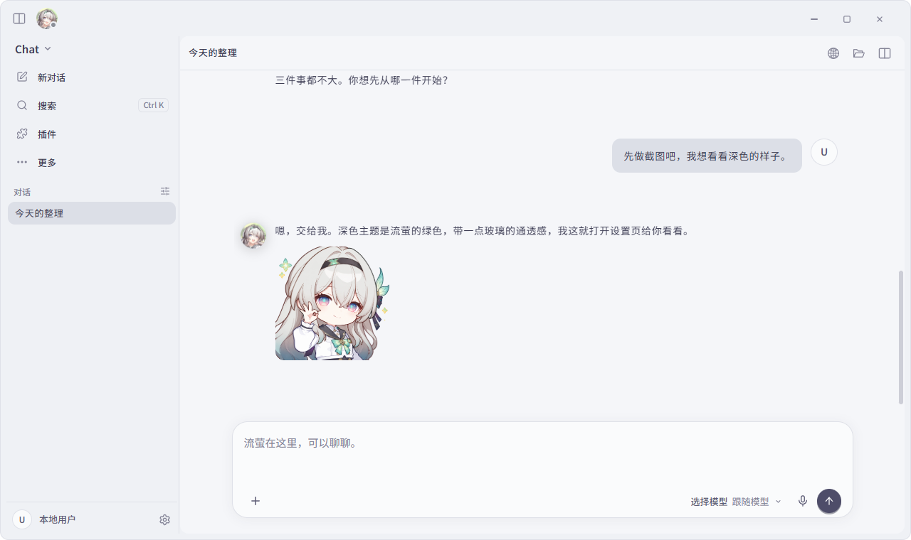
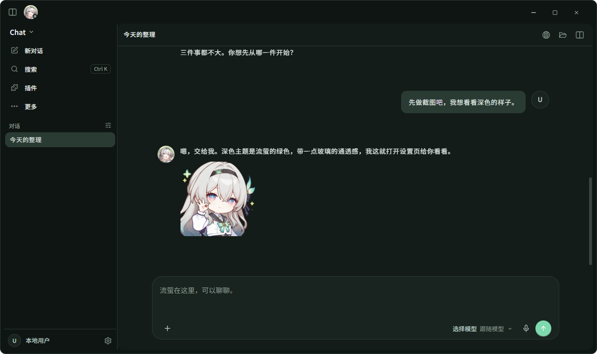
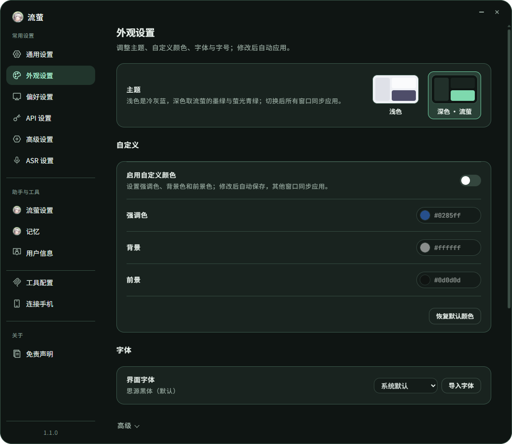

<p align="center">
  
</p>
<p align="center">
  
</p>
<p align="center">
  
  
  
  
  
</p>

<p align="center"><b>一个会陪你聊天、也能陪你把事情做完的桌面流萤。</b></p>

<p align="center">
  <a href="./README.en.md">English</a> ·
  <a href="https://github.com/Serendipity-wu02/Firefly_Agent/issues">问题反馈</a>
</p>

---

Firefly_Agent 是以《崩坏：星穹铁道》流萤为角色的 **Windows 桌面伴侣与 AI 工作台**。

她住在你的桌面上：会眨眼、会应你的双击、聊到合适的时候还会自己丢一张表情包过来。需要干活的时候，同一个她可以读文件、改代码、查资料、整理文档，做完把结果摆回你面前，而不是只丢一句“好的”。

## 她能做什么

**聊天，像在跟一个人说话**
角色设定分层注入，语气、称呼和在意的事保持一致；回复流式出现，会话可回看。心情合适时会自己发表情包，生气的那张不会接在开心之后冒出来。

**干活，每一步都看得见**
Work 处理文件、文档和资料，Code 在你绑定的工作区里读写代码，用 Git、LSP、AST 和命令工具。每次工具调用、审批和取消都有明确的过程展示；任务结束后可以导出 Markdown。学习、测验、笔记和进度也在 Work 里，绑定已有的 Obsidian Vault 或学习资料目录后使用。

**记得住，也分得清**
默认记忆分三层：S 是当前对话的上下文，M 是跨会话的事实记忆，H 是历史检索。H 没有可靠快照时会如实报告覆盖不足，而不是假装“没有这回事”。上下文窗口默认 1M，可按模型档案调整；用到 85% 时自动压缩，让长任务不中途断片。

**能上网，但不乱走**
内置浏览器工作区：你手动浏览，与流萤代你操作是两件事。Agent 只能在你批准的域名和动作里行动，不会进入登录、注册、支付页面，也不会往密码、银行卡、证件号这类输入框里写，并且始终把网页内容当作不可信的外部文字。

**可以接上你自己的东西**
Skills、本地插件、MCP 服务，以及微信、飞书、QQ 渠道（渠道默认只聊天，不开放工具）。凡是会启动命令或改动外部的事（比如安装 MCP、发邮件），都会先放一张确认卡给你，任务一旦取消，这张卡也会一起作废。

## 看看她

| 浅色 | 深色 · 流萤 |
| --- | --- |
|  |  |



<sub>截图来自本仓库当前构建，使用演示对话和隔离的开发数据目录，不含真实对话或凭据；窗口的半透明玻璃质感由系统绘制，截图里看不到。</sub>

## 快速开始

需要 Windows、Node.js `>=24 <25`、npm `>=10`，以及你自己的模型服务（协议、地址、模型和凭据在设置里填）。

```powershell
git clone https://github.com/Serendipity-wu02/Firefly_Agent.git
cd Firefly_Agent
npm ci
$fireflyDevRoot = Join-Path (Get-Location).Path "output\development-profile"
New-Item -ItemType Directory -Force -Path $fireflyDevRoot | Out-Null
$env:FIREFLY_RUNTIME_PROFILE = "development"
$env:FIREFLY_ISOLATION_ROOT = (Resolve-Path -LiteralPath $fireflyDevRoot).Path
npm run dev
```

开发实例的数据放在上面的隔离目录里，不会碰到正式数据（`%APPDATA%\Firefly`）。第一次打开后：

1. **设置 → 模型**：新建一个模型档案，选协议、填地址与密钥，保存后选中它。上下文窗口留空即按 1M。
2. 选 **Chat / Work / Code**；Work、Code 按任务绑定工作区。
3. 想让她用工具、Skills、插件或 MCP，到设置里按需打开。

从源码构建并启动：`npm run build` 后 `npm start`（在同一个已设置隔离变量的 PowerShell 里）。更多脚本见 [scripts/README.md](./scripts/README.md)。

<details>
<summary>开发检查与本地打包</summary>

```powershell
npm run check:renderer
npm test
npm run check:plugin-sdk
npm run test:plugin-examples
npm run validate:skills
npm run package:win:dir
```

`package:win:dir` 生成 Windows 解包目录，并需要 Rust/Cargo（Windows MSVC）与 C++ 构建工具来构建截图与历史辅助程序；它不等于安装器升级或公开发布验收。Windows Bash 集成测试需要按本机安装配置 `FIREFLY_TEST_BASH`；历史辅助程序的测试需要 `FIREFLY_HISTORY_PRESENCE_TEST_HELPER`。
</details>

## 项目地图

| 路径 | 职责 |
| --- | --- |
| `src/main/`、`src/preload/`、`src/renderer/` | 应用服务、受控桥接、React 界面与 Live2D |
| `src/main/orchestrator/` | Agent 编排、工具执行、专业 Agent 与权限 |
| `src/main/memory-context/` | S/M/H 记忆链 |
| `src/main/browser/` | 浏览器工作区与网络策略 |
| `src/main/skills/`、`skills/`、`vendor/firefly-skills/` | Skills 扫描、读取与内置内容 |
| `src/plugins/`、`packages/plugin-sdk/`、`examples/` | 插件宿主、SDK 与示例 |
| `src/shared/` | IPC、数据与事件契约 |
| `prompts/`、`assets/` | 分层角色提示词、世界观与产品资源 |
| `native/` | 原生助手源码 |

开发请先读 [AGENTS.md](./AGENTS.md)。问题反馈与 PR 请不要附密钥、私人对话或用户数据。

## 边界，说在前面

- **要自备**：模型服务、语言服务器、办公程序、语音识别、知识向量资源与渠道凭据。入口在不等于已经配好。
- **数据去向**：设置、凭据、历史和用户 Skills 不在 Git 或安装包里。按你选的服务和操作，对话、资料、工具结果和录音可能发给外部服务。手工处理数据前请先退出并备份。
- **还没做完验收**：真实模型端到端、完整的 Windows 深度 GUI、麦克风与 ASR、外部办公流程、安装器升级与跨平台。自动更新目前关闭，也不承诺公开安装包、在线插件市场或已发布的 SDK 包。
- **界面**：设置页暂时只有中文；聊天窗口语言重启后生效。
- **模型差异**：图像输入按“你的声明 → 厂商模型列表 → 内置目录”判定，无法确认时按纯文本处理；推理内容回放等取决于具体上游。

## 许可证与角色素材

源码采用 [MIT License](./LICENSE)。部分实现源自 [Cyrene-Agent](https://github.com/Playa-0v0/Cyrene-Agent)，保留原版权声明；第三方依赖、Skills、模型、图片与角色 IP 各自遵循自己的许可或授权。

项目所有者确认取得流萤模型原作者授权；仓库尚未归档可核对的作者署名、授权原文、涵盖文件与再分发范围，所以不能据此确认公开再分发的具体范围。模型授权不自动覆盖头像、任务肖像、图标、贴图或派生渲染素材，源码 MIT 许可也不授予这些素材的再分发权。详见 [MODEL_LICENSE.md](./MODEL_LICENSE.md) 与 [THIRD_PARTY_NOTICES.md](./THIRD_PARTY_NOTICES.md)。

流萤及《崩坏：星穹铁道》相关角色形象与知识产权归 HoYoverse / 米哈游及相应权利人所有，本项目为非官方项目。

横幅使用仓库现有模型的渲染画面。技术徽章使用 Shields 官方生成图形与 Simple Icons 标志，来源及许可见 [图标说明](./readme-assets/ICON_SOURCES.md)；技术标签不表示实测通过或官方关联。
