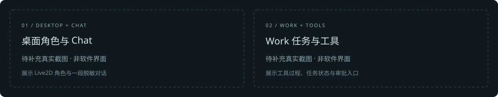

<p align="center">
  
</p>
<p align="center">
  
</p>
<p align="center">
  
  
  
  
  
</p>

---


Firefly_Agent 是以《崩坏：星穹铁道》流萤为角色的 **Windows Live2D 桌面伴侣与 AI 工作台**。与她交流、整理资料、学习和开发项目，让对话中的想法成为可以继续的行动。

[项目仓库](https://github.com/Serendipity-wu02/Firefly_Agent) · [问题反馈](https://github.com/Serendipity-wu02/Firefly_Agent/issues) · [English](./README.en.md)

## 主要能力

- **桌面流萤与 Chat**：Live2D 角色、双击互动表情、拖动与待机动作；角色化对话、模型档案、流式回复与会话历史。
- **Work**：处理文件、文档与知识资料，调用工具和 Skills，通过专业 Agent 协作推进任务；展示工具执行、审批与取消过程。已结束的 Work 任务可导出 Markdown，任务完成与文件完整读取分别展示。
- **Code**：在绑定工作区中阅读和处理代码，使用 Git、LSP、AST、文件和命令工具。语言服务器需要对应语言的运行环境。
- **模型与图像**：提供 OpenRouter 预设与 Chat Completions 入口；图像输入按用户声明、厂商模型列表、内置目录逐层判定，无法确认时按纯文本处理，具体效果取决于所选模型与服务。
- **知识工作区**：学习、测验、笔记与进度能力位于 Work。绑定已有工作区后使用；已有 `learn/progress.md` 的 Vault 才维护进度，普通任务不会自动创建学习目录。
- **记忆与知识**：默认使用 S/M/H 上下文、事实记忆与历史检索链，SQLite 支撑现行记忆核心；角色与文档知识 RAG 独立保留。
- **网页与扩展**：提供网页搜索、正文读取和浏览器工作区；手动浏览与 Agent 授权分离，Agent 只在 Main 当前批准的范围内操作。支持按模式启用 Skills、用户覆盖、本地插件与隔离面板，也可配置外部 MCP 服务。

当前会话模式为 **Chat / Work / Code**。Chat 不委派专业 Agent，通用工具增强需显式开启并勾选；内置角色工具保留自身开关。专业 Agent 用于 Work / Code，需要在设置中绑定可用模型档案；角色、Skills 和头像不会自动扩大工具权限。

## 界面展示



**真实界面截图待补充**：桌面流萤与 Chat、Work 任务及审批、Code 与知识工作区。顶部 GIF 为现有 Live2D 模型的渲染展示，不能代替真实产品界面截图。

## 环境要求

| 项目 | 要求 |
| --- | --- |
| 系统 | Windows 为当前主要开发与验收平台 |
| Node.js | `>=24 <25` |
| npm | `>=10`；项目声明 `npm@11.17.0` |
| 模型服务 | 自行配置应用支持的协议、服务地址、模型和凭据 |
| 可选外部工具 | 按工作流准备语言服务器、办公程序、ASR、知识向量资源与渠道服务 |

本地打包还需要 Rust/Cargo Windows MSVC 与 C++ 构建工具，用于截图及历史辅助程序。源码不附带可直接使用的模型、语音资源或账户凭据。

## 安装与运行

在 PowerShell 中获取源码：

```powershell
git clone https://github.com/Serendipity-wu02/Firefly_Agent.git
cd Firefly_Agent
npm ci
```

创建仓库内的开发隔离目录，并启动：

```powershell
$fireflyDevRoot = Join-Path (Get-Location).Path "output\development-profile"
New-Item -ItemType Directory -Force -Path $fireflyDevRoot | Out-Null
$env:FIREFLY_RUNTIME_PROFILE = "development"
$env:FIREFLY_ISOLATION_ROOT = (Resolve-Path -LiteralPath $fireflyDevRoot).Path
npm run dev
```

隔离根必须是已存在的绝对目录，不能与正式 appData 目录相等或互为父子目录；无效配置会拒绝启动。`npm run dev` 显式选择 development，数据位于上述隔离根下的 `Firefly-development`。

从当前源码构建产物启动，在**已设置上述变量的同一 PowerShell 会话**中执行：

```powershell
npm run build
npm start
```

`npm start` 加载当前仓库的 dist；源码变化后先构建。新终端需重新设置开发隔离变量，另一实例启动前先正常退出当前实例。

常用开发检查与本地解包准备，入口均见 [package.json](./package.json)：

```powershell
npm run check:renderer
npm test
npm run check:plugin-sdk
npm run test:plugin-examples
npm run validate:skills
npm run package:win:dir
```

`package:win:dir` 构建应用、原生助手并准备 MinGit，生成 Windows 解包目录；不等于安装器升级、真实环境或公开发布验收。Windows Bash 集成测试需要按本机实际安装配置 `FIREFLY_TEST_BASH`。更多脚本见 [scripts/README.md](./scripts/README.md)。

## 配置与使用

1. 在设置中创建模型档案，填写实际服务支持的协议、地址、模型和自己的凭据，保存后选择档案。OpenRouter 可使用现有预设；图像能力可选自动、图片或仅文本，用户覆盖会替换厂商列表声明。
2. 选择 Chat、Work 或 Code。Work / Code 按任务绑定工作区，并为需要的专业 Agent 配置已保存的模型档案；未配置时会明确报错。
3. 按需要开启工具、Skills、插件或 MCP。涉及文件写入、命令执行和外部操作时，遵循当前审批与取消机制。
4. 知识工作区使用已有 Obsidian Vault 或学习资料目录；学习进度依赖现有文件和服务结果，不保证每次回复都会写入。
5. 桌面 ASR 可选择关闭、Mossland 或阿里云。明确操作开始录音，停止后转写只填入输入框草稿，不自动发送；桌面 Call / TTS 产品入口已退役。
6. 日程入口位于聊天侧栏的 **More / 更多** 菜单。设置中的连接手机页保留渠道配置，Firefly 手机 App 目前仅为预留接入位，配对按钮不可用。

默认记忆链区分当前上下文、事实记忆与历史检索。H 缺少可信历史快照时会报告覆盖不足，不能据此认定历史不存在；知识 RAG / BGE-M3 需要独立配置，不承担默认个人记忆或历史检索。

正式 production 数据默认位于 `%APPDATA%\Firefly`，开发实例使用上述隔离目录。设置、凭据、历史与用户 Skills 不属于 Git 或安装包；手工处理前退出并备份，保留原目录。根据所选服务与操作，对话、资料、工具结果和录音可能发送至外部服务。

## 当前状态与限制

项目处于持续开发中。功能入口、自动检查和真实环境验收分别说明，不引用历史测试数量作为当前版本结论。

- **需自行准备**：模型服务、知识向量资源、ASR、QQ Music、办公程序、语言服务器与渠道凭据；入口存在不表示相关服务已配置可用。
- **仍需完整验收**：真实模型端到端、深度 GUI、真实用户环境、麦克风及 ASR、QQ Music 完整审批链、外部办公流程、安装器升级和跨平台兼容。
- **浏览器边界**：手动授权不授予 Agent 操作权；Agent 仅能使用已批准的域名与动作，不能自行授权。完整真实 Windows GUI 仍待验收。
- **界面边界**：设置页暂时只有中文，聊天窗口语言选项重启后生效；完整英文设置 UI 尚未完成。旧 Live2D action tool 与运行状态卡片已移除，桌宠保留双击表情与工具执行时的工作表情。
- **模型兼容边界**：OpenRouter 预设、推理字段映射与图像能力判定已有接入；推理内容回放、流式错误的完整兼容和真实模型端点仍需针对具体上游继续验收，不承诺所有模型能力。
- **维护边界**：首次历史列表为空的原始根因仍未确定，已修复读取失败伪装为空列表及随后覆盖文件的问题；成功重开不改变根因结论。
- **发布状态**：自动更新保持关闭；当前不承诺公开安装包、本项目在线插件市场或已发布 SDK 包。角色素材的公开再分发材料仍需归档。

## 架构与目录

应用从 `src/main/index.ts` 启动，编译入口为 `dist/main/main/index.js`；Preload 提供受控 IPC，React 与 Live2D 负责窗口和桌面展示。

| 路径 | 职责 |
| --- | --- |
| `src/main/`、`src/preload/`、`src/renderer/` | 应用服务、受控桥接、React 界面与 Live2D |
| `src/main/orchestrator/` | Firefly Agent 编排、工具执行、专业 Agent 与权限集成 |
| `src/main/skills/`、`skills/` | Skills 扫描注册、读取及项目内置内容 |
| `vendor/firefly-skills/`、`scripts/packaging/` | 正式继承 Skills 目录、来源/许可、历史适配依据与打包校验 |
| `src/plugins/`、`packages/plugin-sdk/`、`examples/` | 插件宿主、本地 SDK、schema 与开发示例 |
| `src/shared/` | IPC、数据/事件契约和 ZIP 安全边界 |
| `prompts/`、`assets/` | 分层角色提示词、世界观及产品资源 |
| `native/`、`electron-builder.yml` | 原生助手源码与应用打包配置 |

开发请阅读 [AGENTS.md](./AGENTS.md)，按修改范围验证并说明未覆盖项。问题反馈与 PR 不要附密钥、私人对话或用户数据。

## 许可证与角色素材

源码采用 [MIT License](./LICENSE)。部分实现源自 [Cyrene-Agent](https://github.com/Playa-0v0/Cyrene-Agent)，保留原版权声明；第三方依赖、Skills、模型、图片与角色 IP 分别遵循各自许可或授权。

项目所有者确认取得流萤模型原作者授权；仓库尚未归档可核对的作者署名、授权原文、所涵盖文件与再分发范围，不能由此确认公开再分发的具体范围。模型授权不自动覆盖头像、任务肖像、图标、贴图或派生渲染素材，源码 MIT 许可也不授予这些素材的再分发权。详见 [MODEL_LICENSE.md](./MODEL_LICENSE.md) 与 [THIRD_PARTY_NOTICES.md](./THIRD_PARTY_NOTICES.md)。

流萤及《崩坏：星穹铁道》相关角色形象与知识产权归 HoYoverse / 米哈游及相应权利人所有，本项目为非官方项目。

横幅使用仓库现有模型的渲染画面。五枚技术徽章使用 Shields 官方生成图形与 Simple Icons 标志，来源及许可见 [图标说明](./readme-assets/ICON_SOURCES.md)；技术标签不表示实测通过或官方关联。
