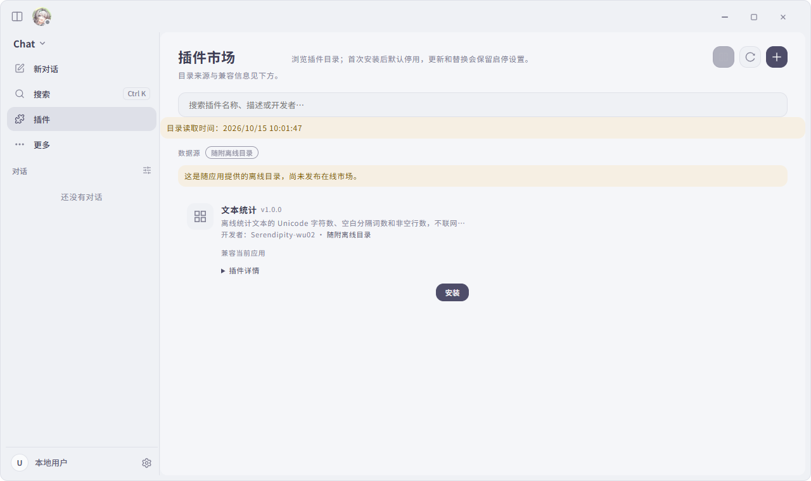
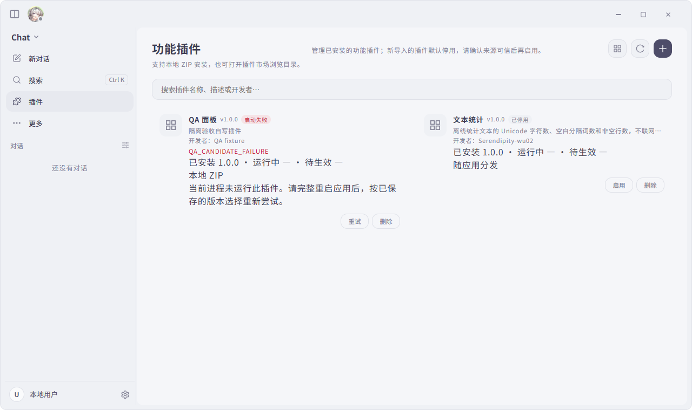

# 插件生命周期与真实 Electron 验收

2026-10-15，基线 `245f5900d77d88d918ad075206ad1eeeba553c08`，目标 `firefly-mini-v1.1.x`。本次覆盖用户插件安装与重启切换、管理入口和设置面板；在线 registry / ZIP 白名单保持为空。

## 行为

- 包保存与运行激活分别返回结果。首次安装默认停用；已有插件的更新保存为独立候选，当前实例继续运行原代码，完整重启后尝试候选。
- 候选失败或中断会恢复持久选择，当前进程不热加载旧版本；下一次完整启动才运行旧选择。禁用更新保留待验证候选，直到首次注册成功。
- 迁移保存真实旧目录身份及树摘要，卸载不按 ID 猜测删除目录。复制前持久化回收标记，首次提交失败或复制中断留下的包仍可被启动清理发现。
- 管理 IPC 验证宿主身份、主框架和实际文档；普通设置保存不能绕写插件配置。设置面板仅绑定运行中实例，停用后销毁 iframe 并拒绝旧桥调用。
- 保留主进程 Node 信任模型、私有数据和 secrets。版本选择恢复不承诺撤销任意文件、网络和数据迁移副作用。详见 [生命周期说明](../packages/plugin-sdk/LIFECYCLE.md)。

## 真实 Electron 验收

使用 Electron 43.7.0、仓库已有 Playwright 和生产构建的实际页面，驱动可复跑：

```powershell
npm run build:main
npm run build:preload
npm run build:renderer
node scripts/verify/plugin-electron-ui.cjs --full
```

Windows 驱动在被忽略的 `output/plugin-electron-ui-<timestamp>/` 中创建独立 profile、APPDATA、临时文件、日志及缓存，逐次启动断言实际路径。测试窗口 HTTP(S) 请求被阻断；未使用真实用户配置、凭据或第三方外部插件。夹具为自写 `qa-panel`，市场只使用仓库随附 `text-stats`，未执行其插件代码。

**最终运行：15 组检查全部通过，10 张截图。** 证据目录尾号 `1792029703242`，`result.json` 为 `ok: true`、`failures: []`。截图已实际查看，非仅检查文件存在。

| 检查 | 实际结果 |
|---|---|
| 窗口及配置隔离 | 每次启动的 userData/session/logs 均位于隔离根 |
| 市场搜索、返回、来源 | 离线来源可见；名称/ID 本地过滤；返回管理页再进入可用 |
| 安装确认 | 取消无安装；确认后默认停用，来源为 bundled，Node 信任提示可见 |
| 重复操作 | 导入等待时禁止重复导入和状态写操作；取消不改状态；已有 pending 时拒绝再次安装 |
| 本地导入和启用 | 自写 ZIP 初始停用，启用后显示实际运行版本和本地来源 |
| 设置面板 | 真实 firefly-plugin 协议 iframe 成功调用归属 IPC 并收到版本 |
| 管理来源 | 设置页可读列表但不能改状态；普通设置写 plugins 被拒绝；其他窗口和同宿主错误文档被拒绝 |
| 面板停止 | 停用后 iframe 从 DOM 移除，主进程拒绝旧面板调用 |
| 更新 | 原实例继续运行 1.0.0，安装/候选为 2.0.0，提示完整重启 |
| 激活失败 | 2.0.0 抛错后无活动实例，选择恢复 1.0.0；当进程重试不能执行旧代码 |
| 再次重启 | 1.0.0 实际运行 |
| 真实中断 | 观察持久状态为 activating 时，仅对自有 Electron PID 树执行强制终止；后续启动恢复 1.0.0 |
| 卸载及数据保留 | 取消保留；确认后列表移除；完整重启后继续移除，私有数据夹具仍保留 |

### 画面证据





本次画面发现并修复了两个真实问题：失败候选的 Manifest 版本残留在卡片标题，与恢复后的已安装版本矛盾；失败状态错误套用“运行版本保持不变”的提示。对应 manager 子进程测试和 renderer 测试均先失败再通过，联合 49 项测试通过。

同时核对并修复了本地替换确认沿用“当前版本会停止运行”的旧文案；该确认文案由 renderer 回归测试先失败再通过，未把它列为本次真实窗口中已操作的同 ID 本地替换场景。

## 审查

先前独立审查检查全部实现与测试，提出迁移目录误删、禁用更新首次激活恢复、首次提交失败孤儿包三个问题。均已通过失败测试复现并修复。后续真实 UI 发现的两项展示问题也已 RED→GREEN。没有宣称审查者再次独立运行了测试或重新签署修复结果。

## 边界与未跑项

- 这是 Playwright 驱动的真实 Electron UI 验收，不是人工鼠标验收。
- 原生文件选择与替换确认由测试入口提供确定结果；未验证系统文件选择器、原生确认框的视觉布局。React 市场与删除确认框实际操作。
- 子框架来源细分由单元测试覆盖；本次实际 IPC 验证包含真实主窗口、设置窗口、非宿主及错误文档，不声称在生产子框架中暴露 Node IPC。
- 未开放或访问在线目录，没有验证远程发布服务；不包含 PR6、自动更新、执行沙箱或任意副作用热回滚。
- 缺少本地截图原生 helper 和可选 embedding 模型时应用按既有方式降级，未影响插件验收。Renderer 构建仍有既有大 chunk 提示。
- Windows 文件 symlink 测试存在平台权限跳过；新增目录 junction 拒绝测试执行通过。最终测试总数与 CI 状态见 PR 描述，不能以这次 UI 结果代替整仓门禁。

## 整仓联动检查

首次整仓本地运行：808 文件，9633 passed / 9 failed / 11 skipped。其中 3 项需要显式选择 Git Bash，5 项需要构建原生 history-presence helper；其余 1 项是本次来源和结果透传改动触发外部技能测试的旧市场文件哈希。

仅将该文件的 canonical LF 哈希推进到已审查实现，保留整文件冻结断言及独立的远程白名单为空断言；没有删除、跳过测试或修改预算/权限规则。选择已有 Git Bash，并使用本机已有 Cargo 缓存离线构建仓库 helper 后，全部 4 个失败文件复验通过：46 + 15 = 61 项测试。该联动不改变外部技能执行或权限模型。最终 SHA 的完整测试和 CI 状态见 PR。
